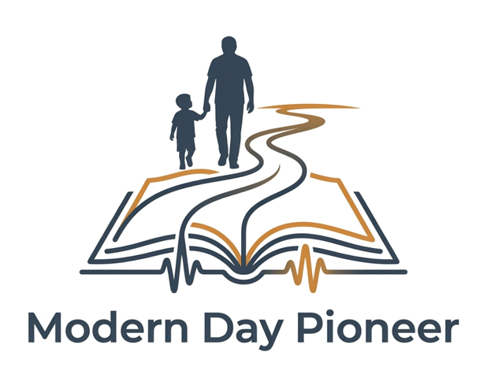

  

<h3 align="center">You are a Pioneer. What is your story?</h3>

Modern Day Pioneer is a free, open-source app that helps a family gather its photos, recordings, videos and stories in one place, connect them to the people and places they belong to, and produce a family history that anyone can open in a web browser. The result needs no internet connection, no special software and no account.

The aim is for that family history to stay usable for decades. No technology can promise that, so the design focuses on reducing the risks: widely used file formats, plain files you can open directly, and no lock-in.

**Get started**

- Website: [moderndaypioneer.org](https://moderndaypioneer.org)
- Download for Windows: [latest release](https://github.com/Modern-Day-Pioneer/modern-day-pioneer-app/releases/latest)
- Questions: [FAQ](https://moderndaypioneer.org/faq/) · [Ask us](https://moderndaypioneer.org/ask/)

**The code**

- [modern-day-pioneer-app](https://github.com/Modern-Day-Pioneer/modern-day-pioneer-app): the app's source code, under the [Apache License 2.0](https://github.com/Modern-Day-Pioneer/modern-day-pioneer-app/blob/main/LICENSE).

Your family's content stays yours. The license covers the app's code, not the photos, recordings and stories you put into it.
